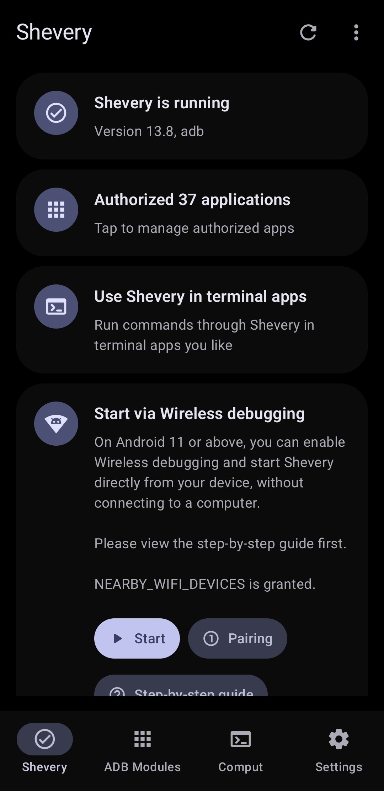
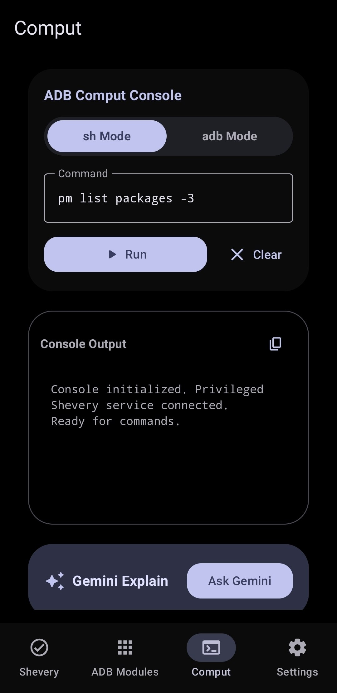
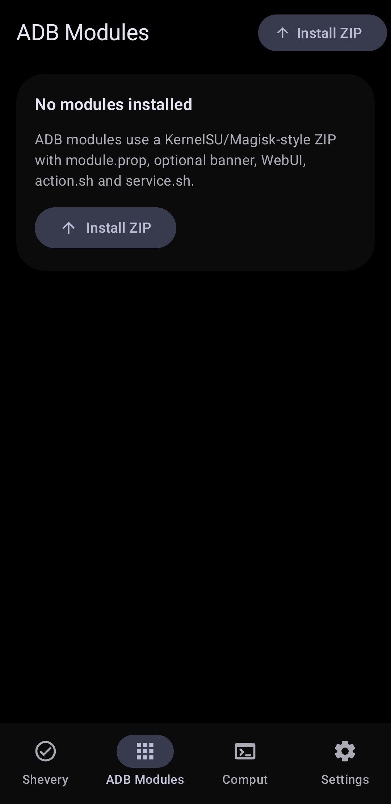
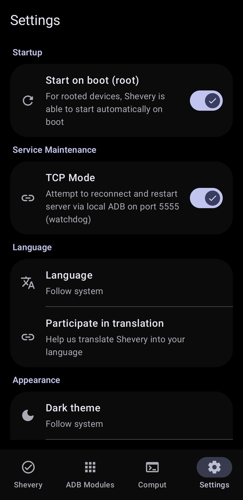

# Shevery

   

[English](README.md) | [Русский](README.ru.md) | [Қазақша](README.kk.md) | [Qazaqşa (Latın)](README.kk-Latn.md) | [Português](README.pt.md) | [Español](README.es.md) | [العربية](README.ar.md) | [简体中文](README.zh-CN.md) | [日本語](README.ja.md)

## Estado do fork

> [!IMPORTANT]
> **Ação de migração necessária:** devido à alteração do identificador do app (`moe.shizuku.privileged.api` -> `com.hamondev.shevery`), você **DEVE DESINSTALAR** qualquer versão antiga do app oficial Shizuku Manager do seu dispositivo antes de instalar o Shevery. Caso contrário, eles entrarão em conflito.
> Referência do projeto original: <https://github.com/RikkaApps/Shizuku>
>

## Novidades do fork

- Interface do gerenciador em Jetpack Compose com componentes Material 3 Expressive, animações, interruptores e ícones arredondados.
- Recurso **«Comput» aprimorado** baseado em shell/adb, com explicações do Gemini, macros e criação de comandos via Commandium AI.
- Trabalho de compatibilidade com Android 16/17 usando SDK e ferramentas de build atuais neste fork.
- Tela de módulos ADB para instalar e gerenciar módulos ZIP.
- Recursos dos módulos: `module.prop`, banner, chave de ativar/desativar, `action.sh`, `service.sh` controlado por política, WebUI local, exclusão, verificações de caminho, limites de tamanho, limites de saída e registros das últimas execuções.
- Configurações de política dos módulos: modo seguro, acesso total e controle de ações em segundo plano.
- Catálogo de módulos com instalação direta.

## Documentação

- [Guia de módulos ADB](docs/adb-modules-guide.md)
- [Referência da API de módulos ADB](docs/adb-modules-api.md)
- [API de conectores Shizuku](docs/shizuku-connectors.md)
- [Compatibilidade com Android 17](docs/android-17-compatibility.md)
- [Guia de publicação de módulos ADB](docs/github-catalog.md)

## Contexto

Ao desenvolver apps que precisam de root, o método mais comum é executar alguns comandos no shell su. Por exemplo, existe um app que usa o comando `pm enable/disable` para ativar/desativar componentes.

Esse método tem desvantagens muito grandes:

1. **Extremamente lento** (criação de múltiplos processos)
2. Precisa processar textos (**super não confiável**)
3. As possibilidades ficam limitadas aos comandos disponíveis
4. Mesmo que o ADB tenha permissões suficientes, o app precisa de root para funcionar

O Shizuku usa uma abordagem completamente diferente. Veja a descrição detalhada abaixo.

## Guia do usuário e download

<https://shizuku.rikka.app/>

## Capturas de tela

  
Clique para abrir as capturas de tela

   
  <table>
    <tr>
      <td align="center"> <b>Tela principal</b></td>
      <td align="center"> <b>Console Comput</b></td>
    </tr>
    <tr>
      <td align="center"> <b>Módulos ADB</b></td>
      <td align="center"> <b>Configurações</b></td>
    </tr>
  </table>

## Como o Shevery funciona?

Primeiro, precisamos falar sobre como os apps usam as APIs do sistema. Por exemplo, se o app quiser obter os apps instalados, todos sabemos que devemos usar `PackageManager#getInstalledPackages()`. Na verdade, isso é um processo de comunicação entre processos (IPC) do processo do app com o processo do servidor do sistema; o framework Android apenas faz o trabalho interno por nós.

O Android usa o `binder` para esse tipo de IPC. O `Binder` permite que o lado do servidor conheça o uid e o pid do lado do cliente, para que o servidor do sistema possa verificar se o app tem permissão para realizar a operação.

Normalmente, se existe um «gerenciador» (por exemplo, `PackageManager`) para os apps usarem, deve existir um «serviço» (por exemplo, `PackageManagerService`) no processo do servidor do sistema. Podemos pensar de forma simples: se o app detém o `binder` do «serviço», ele pode se comunicar com o «serviço». O processo do app recebe os binders dos serviços do sistema ao iniciar.

O Shizuku orienta os usuários a executar primeiro um processo, o servidor Shizuku, com root ou ADB. Quando o app inicia, o `binder` do servidor Shizuku também é enviado ao app.

O recurso mais importante que o Shevery oferece é atuar como intermediário: receber solicitações do app, enviá-las ao servidor do sistema e devolver os resultados. Veja o método `transactRemote` na classe `rikka.shizuku.server.ShizukuService` e a classe `moe.shizuku.api.ShizukuBinderWrapper` para mais detalhes.

Assim, alcançamos nosso objetivo: usar as APIs do sistema com permissões mais altas. E, para o app, é quase idêntico ao uso direto das APIs do sistema.

## Guia do desenvolvedor

### API e exemplo

https://github.com/RikkaApps/Shizuku-API

### Migrando de versões pré-v11

> Os aplicativos existentes continuam funcionando, é claro.

https://github.com/RikkaApps/Shizuku-API#migration-guide-for-existing-applications-use-shizuku-pre-v11

### Atenção

1. As permissões do ADB são limitadas

   O ADB tem permissões limitadas e diferentes conforme a versão do sistema. Você pode ver as permissões concedidas ao ADB [aqui](https://github.com/aosp-mirror/platform_frameworks_base/blob/master/packages/Shell/AndroidManifest.xml).

   Antes de chamar a API, você pode usar `ShizukuService#getUid` para verificar se o Shizuku está rodando como usuário ADB, ou usar `ShizukuService#checkPermission` para verificar se o servidor tem permissões suficientes.

2. Limitação de APIs ocultas a partir do Android 9

   A partir do Android 9, o uso de APIs ocultas é limitado para apps normais. Use outros métodos (como <https://github.com/LSPosed/AndroidHiddenApiBypass>).

3. Android 8.0 e ADB

   Atualmente, o serviço Shizuku obtém o processo do app combinando `IActivityManager#registerProcessObserver` e `IActivityManager#registerUidObserver` (26+) para garantir que o processo do app seja enviado ao iniciar. Porém, na API 26, o ADB não tem permissão para usar `registerUidObserver`; por isso, se você precisar usar o Shizuku em um processo que talvez não seja iniciado por uma Activity, recomenda-se disparar o envio do binder iniciando uma activity transparente.

4. O uso direto de `transactRemote` exige atenção

   * A API pode ser diferente em versões distintas do Android; verifique com cuidado. Além disso, `android.app.IActivityManager` existe na forma aidl na API 26 e posteriores, e `android.app.IActivityManager$Stub` existe apenas na API 26.

   * `SystemServiceHelper.getTransactionCode` pode não obter o código de transação correto; por exemplo, `android.content.pm.IPackageManager$Stub.TRANSACTION_getInstalledPackages` não existe na API 25, e lá existe `android.content.pm.IPackageManager$Stub.TRANSACTION_getInstalledPackages_47` (esse caso já foi tratado, mas não se exclui que possa haver outras situações). Esse problema não ocorre com o método `ShizukuBinderWrapper`.

## Desenvolvendo o próprio Shizuku

### Build

- Clone com `git clone --recurse-submodules`
- Execute a tarefa do Gradle `:manager:assembleDebug` ou `:manager:assembleRelease`

A tarefa `:manager:assembleDebug` gera um servidor depurável. Você pode anexar um depurador ao `shizuku_server` para depurar o servidor. Atenção: no Android Studio, em «Run/Debug configurations», a opção «Always install with package manager» deve estar marcada, para que o servidor use o código mais recente.

## Licença

Todos os arquivos de código deste projeto são licenciados sob Apache 2.0

## Créditos

* [kerneldroid](https://github.com/kerneldroid) - por partes da interface do app, do sistema de catálogo de módulos e do suporte ao Android 17.
* [RikkaApps/Shizuku](https://github.com/rikkaapps/Shizuku) - pela Shizuku API e pelas fontes principais.
* [Landon Moran](https://github.com/LandonMoran) - por correções de Dhizuku, TCP etc.
* [DP-Hridayan](https://github.com/DP-Hridayan/aShellYou) - por partes da interface «Comput».
* [protonpony/Shizuku-Keeper](https://github.com/protonpony/Shizuku-Keeper) - pelo «Início automático na inicialização via depuração sem fio».

## E mais...

Agora você pode publicar seu módulo ADB!
Siga estes passos:
- Crie seu módulo.
- Crie um repositório GH para este módulo.
- Adicione o tópico «shevery-modules».
- Adicione os fontes e o release com o módulo.

> [!CAUTION]
> **Aviso de app gratuito**
>
> O Shevery é um app **totalmente gratuito**. Não pague a gerenciadores de arquivos de terceiros nem a serviços de nuvem para baixar este aplicativo.
